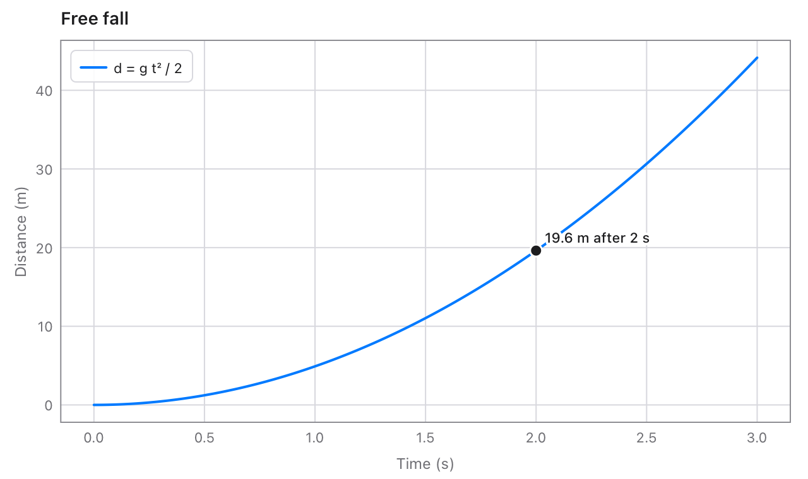
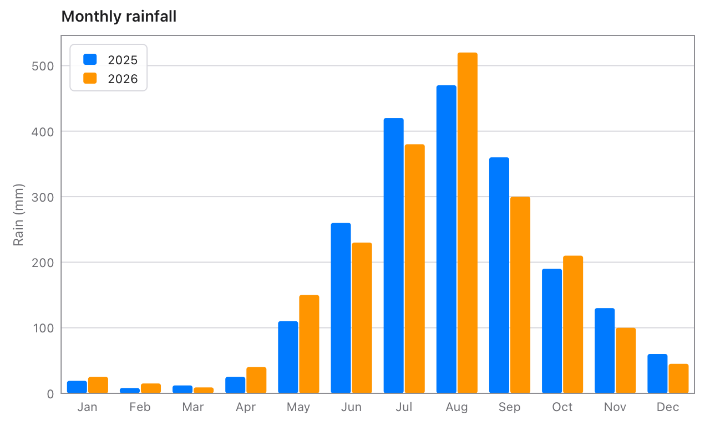
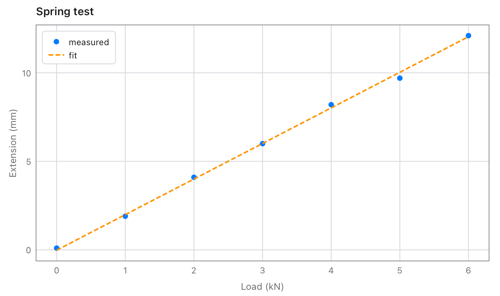
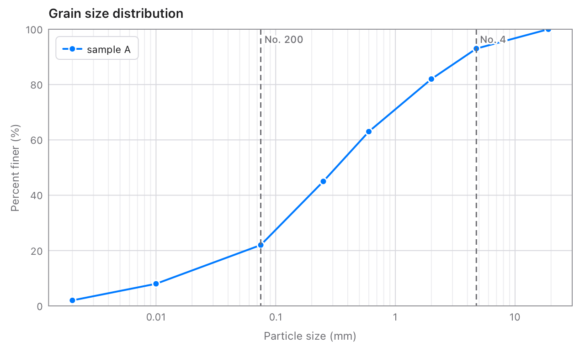
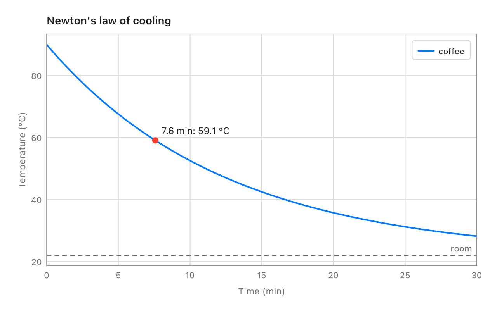
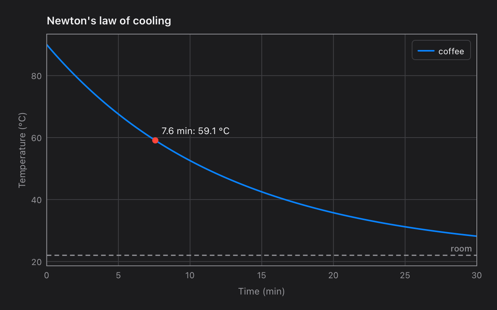

# chart

Charts for [Tessel](https://tessel-lang.syncster.dev) programs: lines,
dots, areas and bars, on linear or log axes, with ticks, titles and a
legend worked out for you. Draw one into a `Canvas`, or save it as a PNG
or a PDF from a program with no window at all.

```tessel
import chart

fn main() {
    var c = chart.Chart(title: "Free fall", xLabel: "Time (s)", yLabel: "Distance (m)")
    c.function(from: 0, to: 3, name: "d = g t² / 2") { t in 9.81 * t * t / 2.0 }
    c.point(x: 2, y: 19.62, label: "19.6 m after 2 s")
    c.savePNG("fall.png")
}
```



## Using it

Add it to a project (Tessel 0.10 or later):

```sh
tessel add chart
```

then `import chart`. Make a `chart.Chart`, add data to it, and draw or
save it. A chart is a plain value: build it with `var`, and make a new one
whenever the data changes.

## What goes on a chart

| Method | Draws |
|---|---|
| `line(xs, ys, name:, color:, width:, dash:, markers:)` | A line through the points, in order. `dash: [6, 3]` makes it dashed; `markers: true` puts a dot on each point. |
| `scatter(xs, ys, name:, color:, size:)` | A dot at each point. |
| `area(xs, ys, name:, color:, width:)` | A line with the space down to the x axis (to 0, when 0 is on it) lightly filled. |
| `bars(labels, values, name:, color:)` | A bar for each category. Several `bars` calls stand side by side. |
| `function(from:, to:, steps:, name:, …) { x in … }` | The line of y = f(x). |
| `horizontalLine(y, label:, color:)` | A dashed level across the chart, named at its right end. |
| `verticalLine(x, label:, color:)` | A dashed line up the chart, named at its top. |
| `point(x:, y:, label:, color:)` | A dot with a label beside it. |

Everything but the data is optional. A series with a `name` is listed in
the legend. A series with no `color` gets the next of the chart's
`colors` (blue, orange, green, red, purple, pink, gray, yellow). A value
that is `NaN`, or 0 or less on a log axis, breaks the line there.

```tessel
var rain = chart.Chart(title: "Monthly rainfall", yLabel: "Rain (mm)")
let months = ["Jan", "Feb", "Mar", "Apr", "May", "Jun", "Jul", "Aug", "Sep", "Oct", "Nov", "Dec"]
rain.bars(months, [19, 8, 12, 25, 110, 260, 420, 470, 360, 190, 130, 60], name: "2025")
rain.bars(months, [25, 15, 9, 40, 150, 230, 380, 520, 300, 210, 100, 45], name: "2026")
```



```tessel
var fit = chart.Chart(title: "Spring test", xLabel: "Load (kN)", yLabel: "Extension (mm)")
fit.scatter([0, 1, 2, 3, 4, 5, 6], [0.1, 1.9, 4.1, 6.0, 8.2, 9.7, 12.1], name: "measured")
fit.line([0, 6], [-0.02, 12.04], name: "fit", dash: [6, 3])
```



## The chart's settings

They're the `Chart`'s fields: give them when you make it (in this order),
or set them afterwards.

| Field | |
|---|---|
| `title`, `xLabel`, `yLabel` | The title, and what each axis shows. |
| `xMin`, `xMax`, `yMin`, `yMax` | The axes' ranges. Left out, each is worked out from the data: lines fill the width exactly, dots get a little room, the y axis gets 5% to spare, and bars and areas stand on 0. |
| `xScale`, `yScale` | `.linear`, or `.log` for values over several powers of ten. |
| `equalAspect` | A unit as long across as up, for maps and cross-sections. |
| `grid` | Lines across the plot at the ticks (on by default). |
| `legend` | `.automatic` (the corner covering the least data), `.topLeading`, `.topTrailing`, `.bottomLeading`, `.bottomTrailing` or `.hidden`. |
| `colors` | The colors series get in turn. |

```tessel
var grain = chart.Chart(title: "Grain size distribution", xLabel: "Particle size (mm)", yLabel: "Percent finer (%)",
    yMin: 0, yMax: 100, xScale: .log)
grain.line([0.002, 0.01, 0.075, 0.25, 0.6, 2.0, 4.75, 19], [2, 8, 22, 45, 63, 82, 93, 100], name: "sample A", markers: true)
grain.verticalLine(0.075, label: "No. 200")
grain.verticalLine(4.75, label: "No. 4")
```



## Drawing and saving

| Method | |
|---|---|
| `draw(g, x:, y:, width:, height:)` | Draws into a `Canvas`'s (or `renderImage`'s) `Graphics`: the whole canvas, or the rectangle given, so one canvas can hold several charts. Returns the `Frame`. |
| `savePNG(path, width:, height:, scale:, background:)` | Saves a PNG (a JPEG if the path ends in `.jpg`), 720 × 450 points at 2 pixels per point unless you say. |
| `savePDF(path, width:, height:)` | Saves a one-page PDF, with lines and text kept sharp at any size. |
| `frame(g, x:, y:, width:, height:)` | The `Frame` that `draw` would use, without drawing. |

In a window, the chart follows the light or dark appearance by itself.
`draw` returns a `Frame`. Its `px(x)` and `py(y)` turn data values into
points on the canvas, for drawing more on top, and `xAt(px)` and
`yAt(py)` turn points back into data values, for reading the value under
the mouse:

```tessel
import chart

// A chart in a window, with a readout that follows the mouse.
app Cooling(title: "Cooling", width: 640, height: 400) {
    state mouseX: Float = -1.0

    Canvas { g in
        var c = chart.Chart(title: "Newton's law of cooling", xLabel: "Time (min)", yLabel: "Temperature (°C)")
        c.function(from: 0, to: 30, name: "coffee") { t in 22.0 + 68.0 * exp(-0.08 * t) }
        c.horizontalLine(22, label: "room")
        let f = c.draw(g)
        // The mouse's position, turned into a time on the chart.
        let t = f.xAt(mouseX)
        if t >= 0.0 && t <= 30.0 {
            let temp = 22.0 + 68.0 * exp(-0.08 * t)
            g.fillCircle(x: f.px(t), y: f.py(temp), radius: 4, color: .red)
            g.text("{t.formatted(decimals: 1)} min: {temp.formatted(decimals: 1)} °C", x: f.px(t) + 8.0, y: f.py(temp) - 6.0, size: 12, align: .bottomLeading, halo: .background, haloWidth: 2.0)
        }
    }
    .onPointer { e in
        mouseX = e.x
    }
    .padding(12)
}
```





The `Frame` also has the plot area's `left`, `top`, `width`, `height`,
`right` and `bottom`, the data range it shows, and `contains(px, py)`.

## Ticks

The functions that place the ticks are public too, for drawing axes of
your own: `tickStep(span:count:)` gives a round step (1, 2 or 5 times a
power of ten), `ticks(from:to:count:)` and `logTicks(from:to:count:)` the
values, and `tickLabel(value, step:)` the text, with as many decimals as
the step needs and very large or small numbers written like `2.5e6`.

## Mistakes

Data that doesn't fit together, like 5 x values with 4 y values, or bars
with a different number of values than the chart has categories, is a
mistake in the code. It stops the program with a message:

```text
chart: line got 5 x values but 4 y values: they must be as many
```

## Tests

```sh
tessel run tests
```

checks the ticks, their labels, the frame's arithmetic and the ranges
worked out from data, saves charts of every kind (and every example
here), and exits with 1 if any check fails. The pictures go to the
temporary folder, to look at. `tessel run examples` saves this README's
pictures in `docs/`.

## What's where

| File | |
|---|---|
| `chart.tsl` | `Chart`, `Series`, `Guide`, `Mark`, `LegendPlace` and `palette`. |
| `axis.tsl` | `Frame`, `Scale`, and the ticks: `tickStep`, `ticks`, `logTicks`, `tickLabel`. |
| `draw.tsl` | Laying out and drawing a chart: ranges, the plot area, series, guides, legend. |
| `tests/main.tsl` | The tests. |
| `examples/main.tsl` | Makes the pictures in `docs/`. |
| `tessel.toml` | The library's name, version, description and licence. |

## Licence

MIT: see [LICENSE](LICENSE).
